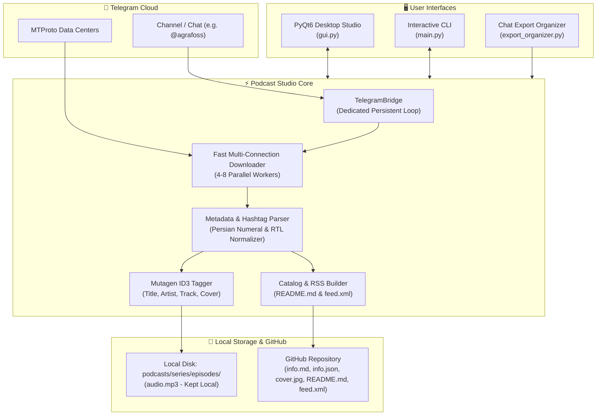

<div align="center">

# 🎙️ Telegram Podcast Studio & Downloader
### High-Speed Parallel Downloader, ID3 Tagger, Metadata Studio & GitHub Archiver

[](https://www.python.org/)
[](https://github.com/LonamiWebs/Telethon)
[](https://riverbankcomputing.com/software/pyqt/)
[](https://mutagen.readthedocs.io/)
[](https://github.com/cher-nov/cryptg)
[](LICENSE)
[](https://github.com/younes-qasempour/Podcast-Manger.git)

<p align="center">
  <b>A comprehensive, high-performance desktop studio to download, organize, tag, edit, and catalog podcast series from Telegram channels directly into Git and GitHub archives.</b>
</p>

[Key Features](#-key-features) •
[Quick Start](#-quick-start) •
[Desktop Studio GUI](#-desktop-studio-gui) •
[Speed Engine](#-high-speed-multi-connection-engine) •
[Storage Architecture](#-storage--archive-structure) •
[CLI Reference](#-command-line-interface-cli) •
[Security & Privacy](#-security--privacy-guarantee)

---

</div>

## 🌟 Overview

Downloading podcast series from Telegram channels often comes with challenges:
* **Single-connection throttling:** Standard Telegram downloads transfer sequentially in small 64 KB chunks, yielding slow transfer rates (~150 KB/s).
* **Mixed channel contents:** Large channels (e.g. `@agrafoss`) publish hundreds of episodes across diverse topics and books mixed together.
* **Corrupted or reversed Persian text:** Right-to-Left (RTL) strings and Persian/Eastern numerals (`۱-۹`) often get reversed or misaligned by terminal encoders.
* **GitHub 100 MB file limit:** Audio files frequently exceed GitHub's upload limits, risking broken pushes.

**Telegram Podcast Studio & Downloader** solves all of these problems in one cohesive platform. It delivers a fast multi-connection parallel downloader (5x–15x faster), automated hashtag series segmentation (e.g. `#چنین_گفت_زرتشت`), automatic ID3 tagging with embedded covers, a desktop metadata editor, and automated catalog/RSS feed generation.

---

## ✨ Key Features

- ⚡ **High-Speed Multi-Connection Engine (`fast_telethon`):**
  Splits large audio files into 512 KB chunks and downloads them across **4 to 8 parallel MTProto connections** with hardware AES decryption (`cryptg`), maximizing bandwidth utilization.
- 🖥️ **Full Desktop Studio (PyQt6):**
  - **In-App Telegram Login:** Link via instant QR Code scan on your Telegram mobile app, or phone number with Two-Step Verification (2FA) support.
  - **Channel Scanner & Series Filter:** Scan any public or private channel and filter tracks by series hashtag.
  - **Episode Checklist:** Select episodes with helpers (`All`, `None`, `Latest 5`, `Latest 10`, `Un-downloaded Only`) and live selection stats (episodes and total megabytes).
  - **Metadata Studio:** Edit title, speaker/artist, episode number, and Persian descriptions with full RTL text support.
  - **Drag-and-Drop Thumbnail Customizer:** Drop custom JPG/PNG images directly onto the artwork pane to update cover art and re-embed ID3 tags.
  - **Inline Audio Player:** Preview and play local tracks directly in your default media player.
- 🏷️ **Automated ID3 Tagging:**
  Embeds Title, Artist, Album/Series, Track Number, Year, Persian notes, and front cover art into audio files via `mutagen`.
- 📚 **Catalog & RSS Feed Builder:**
  Generates clean Markdown table-of-contents catalogs (`README.md`) and standard podcast RSS feeds (`feed.xml`) for every series.
- 🔄 **Zero-API Telegram Desktop Export Mode:**
  Import chat history exports (`result.json` or `messages.html`) without requiring API keys.
- 🔒 **Zero-Leakage Privacy Policy:**
  Telegram sessions, `.env` files, and heavy `*.mp3` audio tracks are strictly ignored by `.gitignore`. Notes, thumbnails, and catalogs sync cleanly to GitHub.

---

## 🏗️ Architecture



---

## 🚀 Quick Start

### 1. Prerequisites
* **Python 3.10+** (Tested on Python 3.10, 3.11, 3.12, 3.13, 3.14)
* **Git** installed and available in PATH

### 2. Clone the Repository
```bash
git clone https://github.com/younes-qasempour/Podcast-Manger.git
cd Podcast-Manger
```

### 3. Install Dependencies
```bash
pip install -r requirements.txt
```

### 4. Run the Desktop Studio (Recommended)
Double-click `run_gui.bat` on Windows, or run:
```bash
python gui.py
```

### 5. Run the Command Line Interface
Double-click `run.bat` on Windows, or run:
```bash
python main.py
```

---

## 🖥️ Desktop Studio GUI

The application includes a PyQt6 desktop interface organized into three tabs:

```
┌────────────────────────────────────────────────────────────────────────┐
│ 🎙️ Telegram Podcast Studio & Downloader        🟢 Connected as: Younes │
├────────────────────────────────────────────────────────────────────────┤
│ [📚 Podcast Library & Studio] [📥 Telegram Downloader] [🐙 GitHub Sync]│
├────────────────────────────────────────────────────────────────────────┤
│ 1. Target Telegram Channel: [@agrafoss       ] [🔗 Scan Podcasts]     │
│ 📚 Series: [#چنین_گفت_زرتشت (92)] [☑️ All] [☐ None] [✨ Latest 5]       │
│                                                                        │
│ [x] Ep #001 | تحلیل «چنین گفت زرتشت» (۱)      | 40:56 | 37.5 MB       │
│ [x] Ep #002 | تحلیل «چنین گفت زرتشت» (۲)      | 56:32 | 52.3 MB       │
│ ...                                                                    │
│ Overall: [████████████████████░░░░░] 65%                               │
│ Current: [█████████████████████████] 100% | 4.2 MB/s                   │
│                                                                        │
│ [📥 Download Selected Episodes]              [⛔ Cancel Download]      │
└────────────────────────────────────────────────────────────────────────┘
```

### Tab 1: 📥 Telegram Downloader
1. Enter the channel username (e.g. `@agrafoss` or full link `https://t.me/agrafoss`).
2. Click **🔗 Scan Podcasts in Channel**.
3. Filter by series (e.g. `#چنین_گفت_زرتشت`).
4. Select episodes using the interactive table or quick buttons (`Latest 5`, `Latest 10`, `Un-downloaded Only`).
5. Click **📥 Download Selected Episodes**. Dual progress bars show live download speed, percentage, and ETA.

### Tab 2: 📚 Podcast Library & Studio
1. Browse downloaded podcast series and episodes.
2. Search episodes by title, episode number, or keywords in Persian/English.
3. Edit titles, host/artist, and detailed markdown notes.
4. Drag and drop any image file into the artwork box to replace the thumbnail.
5. Click **💾 Save Changes** to update `info.json`, `info.md`, embed new ID3 tags into `audio.mp3`, and rebuild the catalog.

### Tab 3: 🐙 GitHub Sync & Settings
1. Configure your remote GitHub repository URL.
2. Click **🚀 Commit & Push Entire Archive to GitHub** to sync notes, thumbnails, and catalog tables.
3. Rebuild RSS feeds and catalogs with a single click.

---

## ⚡ High-Speed Multi-Connection Engine

Standard Telethon downloads use a single connection with 64 KB sequential chunks, resulting in download speeds of 100–200 KB/s on high-latency routes.

`fast_telethon.py` introduces parallel chunk downloads:
* **Multi-Part Concurrency:** The file is segmented into 512 KB blocks and downloaded simultaneously through **4 to 8 parallel MTProto connections**.
* **Hardware AES Decryption:** Utilizes `cryptg` for C-level hardware AES decryption.
* **Resilient Fallback:** Automatically falls back to standard single-connection transfer if connection limits are reached.
* **Instant Cancellation:** Cancellation signals abort transfers cleanly without leaving corrupted temporary files.

| Method | Connections | Chunk Size | Typical Speed | 150 MB Download Time |
| :--- | :---: | :---: | :---: | :---: |
| **Standard Telethon** | 1 | 64 KB | ~140 KB/s | ~18 minutes |
| **Fast Multi-Connection** | 4 – 8 | 512 KB | **2.5 – 10+ MB/s** | **~20 – 40 seconds** |

---

## 📁 Storage & Archive Structure

```text
podcasts/
└── چنین_گفت_زرتشت/
    ├── README.md                      # Master catalog table of contents
    ├── feed.xml                       # Podcast RSS feed (Apple Podcasts compliant)
    └── episodes/
        ├── 001 - تحلیل «چنین گفت زرتشت» (۱)/
        │   ├── audio.mp3              # ID3-tagged audio file (Kept locally)
        │   ├── cover.jpg              # High-resolution episode thumbnail
        │   ├── info.md                # Persian notes, description & timestamps
        │   └── info.json              # Structured metadata (duration, bytes, ID)
        ├── 002 - تحلیل «چنین گفت زرتشت» (۲)/
        │   ├── ...
        └── 092 - تحلیل «چنین گفت زرتشت» (۹۲)/
            ├── ...
```

### Sample `info.md`
```markdown
# تحلیل «چنین گفت زرتشت» (92)
- **Series:** چنین_گفت_زرتشت
- **Speaker:** علی شاهی
- **Episode:** #92
- **Duration:** 01:58:59 | **Size:** 163.4 MB
- **Source:** [Telegram Post #297](https://t.me/agrafoss/297)

---

### Description & Notes:
گزارش و تحلیل «چنین گفت زرتشت» اثر فریدریش نیچه - علی شاهی
اپیزود ۹۲:
بخش سوم: «شفایافته»
بالاخره رسیدیم به پرسش بزرگ «بازگشت جاودان چیست؟»...
#چنین_گفت_زرتشت
```

---

## 💻 Command Line Interface (CLI)

The CLI offers full automation support for scripting, server environments, and headless operation:

```bash
# Interactive interactive menu
python main.py

# Download specific series by hashtag
python main.py --series "#چنین_گفت_زرتشت"

# Download the latest 5 episodes of a series
python main.py --series "#چنین_گفت_زرتشت" --latest 5

# Download a range of episodes (e.g. 1 to 10)
python main.py --series "#چنین_گفت_زرتشت" --episodes 1-10

# Download all episodes and push catalog to GitHub
python main.py --series "#چنین_گفت_زرتشت" --download-all --push

# Organize a Telegram Desktop chat export folder (Zero API Mode)
python main.py --import-export "C:\Downloads\ChatExport_2026-11-06" --push

# Commit and push current local archive to GitHub
python main.py --push
```

---

## ⚙️ Configuration (`.env`)

Configuration is managed via `.env` (copy from `.env.example`):

```ini
# Telegram API Credentials
# Official desktop credentials are provided out-of-the-box as default fallbacks
TG_API_ID=2040
TG_API_HASH=b18441a1ff607e10a989891a5462e627
TG_PHONE=+989123456789
TG_SESSION_NAME=tg_podcast_session

# Target Channel
TARGET_CHANNEL=@agrafoss

# Storage Options
OUTPUT_DIR=./podcasts
DOWNLOAD_AUDIO=true
DOWNLOAD_THUMBNAIL=true
EMBED_METADATA_IN_MP3=true

# Proxy Settings (SOCKS5 / HTTP)
PROXY_ENABLED=false
PROXY_TYPE=socks5
PROXY_HOST=127.0.0.1
PROXY_PORT=10808

# GitHub Remote URL
GIT_REMOTE_URL=https://github.com/younes-qasempour/Podcast-Manger.git
GIT_PUSH_AUDIO=false
```

---

## 🔒 Security & Privacy Guarantee

1. **Zero Secret Leaks:**
   * `.env`, session database files (`*.session`, `*.session-journal`), and authentication cache are explicitly excluded in `.gitignore`.
2. **Audio Stays Local:**
   * `GIT_PUSH_AUDIO=false` ensures that large media files (`*.mp3`, `*.m4a`) remain stored locally on your machine, preventing push errors caused by GitHub's 100 MB file limit.
   * Markdown notes (`info.md`), thumbnails (`cover.jpg`), JSON metadata (`info.json`), master catalogs (`README.md`), and RSS feeds (`feed.xml`) are safely tracked and pushed.

---

## 🤝 Contributing

Contributions, bug reports, and suggestions are welcome!
1. Fork the Project
2. Create your Feature Branch (`git checkout -b feature/AmazingFeature`)
3. Commit your Changes (`git commit -m 'Add some AmazingFeature'`)
4. Push to the Branch (`git push origin feature/AmazingFeature`)
5. Open a Pull Request

---

## 📄 License

Distributed under the **MIT License**. See [`LICENSE`](LICENSE) for more information.

Developed by [Younes Qasempour](https://github.com/younes-qasempour).
